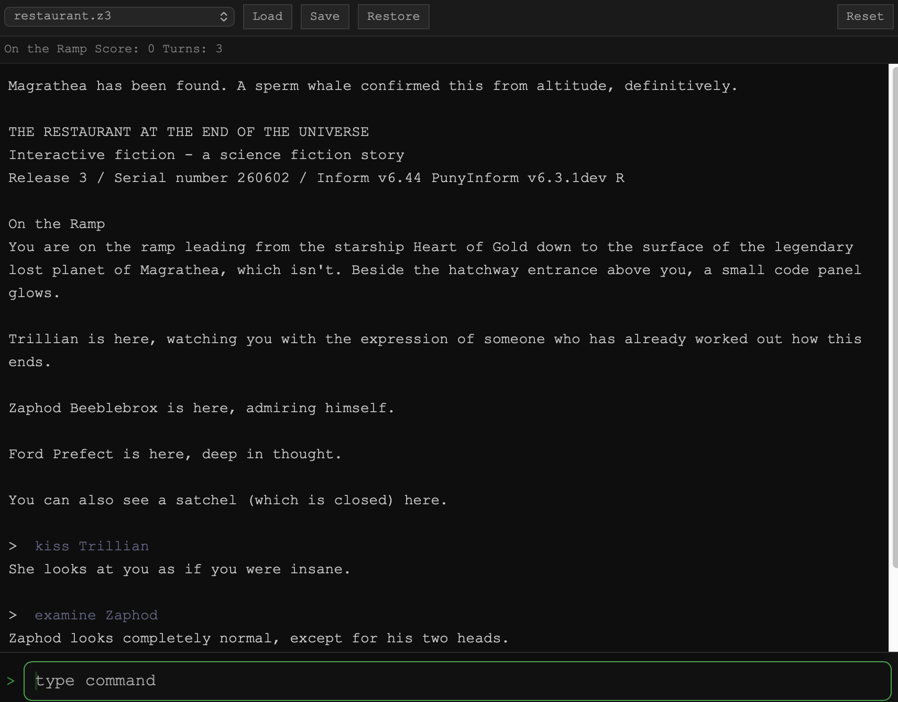

# zVibe

[](https://github.com/emuck/zvibe/actions/workflows/ci.yml)

Z-machine version 3 interpreter for resource-constrained embedded systems, with optional version 4 support.

**[Project page →](https://emuck.github.io/zvibe/)**

**[Development history and milestones &rarr;](docs/HISTORY.md)** — from first interpreter to dual-board FPGA hardware, with a web terminal.

## Description

zVibe is a Z-machine v3 interpreter (with version 4 as a build option) written in C targeting microcontrollers
and FPGA soft-cores. The Z-machine engine uses a 16KB static buffer; supported
embedded targets require 32KB total RAM for firmware, engine, and stack. It uses a split memory model
that keeps only the dynamic portion of a story file in RAM while reading static
content directly from flash, reducing working-set memory by ~90% compared to
a conventional full-image interpreter. The same core library builds for desktop
(Linux, macOS, Windows), ARM Cortex-M4, and a SERV RISC-V soft-core on Intel
MAX10 and Xilinx Arty S7-50 FPGAs.

The Z-machine core is derived from prior work; attribution in [THIRD_PARTY_NOTICES.md](THIRD_PARTY_NOTICES.md).


*zVibe running in a webterm target*

## Goals

- **Z-machine v3, and v4 as a build option.** v3 is the last version where the full spec fits a static-allocation model, so it stays the default and is as small as it ever was. v4 (*Bureaucracy*, *Trinity*, *A Mind Forever Voyaging*) needs no undo or extended opcodes, so it is compiled in with `ZVIBE_ENABLE_V4=1`; a V3-only build contains none of it. V5 and later add undo, extended opcodes, and larger tables that strain the static-allocation model and are out of scope. See [docs/V4_DESIGN.md](docs/V4_DESIGN.md).
- **Minimal RAM.** The interpreter must run on targets with 32KB of working memory.
- **No heap allocation.** All state is statically sized; no `malloc` at runtime.
- **Single C library.** Platform-specific code is isolated to thin HAL layers.
- **Embeddable.** The core exposes a clean C API with callback-based I/O.

## Architecture

```
src/core/       Z-machine interpreter (platform-agnostic C99)
src/api/        Public C API (zvibe_api.h)
src/screen/     ANSI/VT100 screen layer for V4 split windows (optional)
target/console/ Desktop frontend — Linux, macOS, Windows
target/same51/  SAM E51 Cortex-M4 port
target/riscv/   SERV RISC-V soft-core (MAX10 and Arty S7-50)
target/webterm/ Web terminal session layer and POSIX server
```

| Target | Version 3 | Version 4 |
|---|---|---|
| Console (Linux, macOS) | yes | yes — full-screen terminal player |
| Console (Windows) | yes | plain line mode only |
| SAM E51 | yes | yes — single-game firmware (`make v4`), saves packed against the story |
| RISC-V (MAX10, Arty S7-50) | yes | not yet |
| Web terminal | yes | yes — screen drawn in the browser (`zterm.js`) |

Memory layout at runtime:

```
┌──────────────────────┐
│   Dynamic memory     │  → RAM   (2–14 KB for v3 stories, all known titles fit in 16 KB; v4 stories need more, e.g. Bureaucracy about 18 KB)
├──────────────────────┤
│   Static memory      │  → Flash / XIP (read in place)
└──────────────────────┘
```

The boundary is determined by the `staticmem` field in the story file header.
Everything below the boundary is copied to RAM at load time; everything above
is read on demand from the flash address space.

Runtime data flow:

```
story.z3
    |
    +-- dynamic (mutable)  --> RAM (16 KB buffer)
    +-- static (read-only) --> Flash / XIP
    |
interpreter (C99, zvibe_api.h, no heap)
    |
    +-- ARM Cortex-M4  (SAM E51)
    +-- FPGA SERV      (MAX10, Arty S7-50)
    +-- desktop        (Linux, macOS, Windows)
    +-- web terminal   (WebSocket)
```

For RISC-V targets, the SoC is built around the
[SERV](https://github.com/olofk/serv) bit-serial RV32I CPU with a custom
Wishbone-attached UART, UFM/QSPI XIP controller, and save-slot manager.

See [docs/ARCHITECTURE.md](docs/ARCHITECTURE.md) for a full design walkthrough.

## Supported targets

| Target | Platform | RAM | Storage |
|---|---|---|---|
| console | Linux, macOS, Windows | host | host filesystem |
| same51 | SAM E51 Cortex-M4 | 256 KB | EEPROM |
| riscv/max10 | SERV on Intel MAX10 08 | 32 KB | 172 KB UFM |
| riscv/arty | SERV on Xilinx Arty S7-50 | 32 KB | 16 MB QSPI |

## Quick start

Prerequisites: GCC (or Clang) and Make.

```bash
# Ubuntu
sudo apt install build-essential

# macOS — Xcode command-line tools supply cc and make
xcode-select --install
```

Build and run the bundled test suite:

```bash
cd target/console
make clean && make
echo quit | ./build/bin/zvibe_minimal ../../games/catalog/czech.z3
```

To play a story file interactively:

```bash
./build/bin/zvibe_console path/to/game.z3
```

See [docs/BUILDING.md](docs/BUILDING.md) for platform-specific instructions
and embedded target build procedures.

## Testing

```bash
# Unit tests (memory subsystem, 133 assertions)
cd target/console/tests && make test-unit

# Z-machine opcode conformance (368 tests, bundled game)
make test-czech

# Console build + unit tests + czech suite (matches CI)
make validate

# The same with version 4 compiled in, plus the Czech V4 gate (386 tests, as frotz)
make validate-v4

# Web terminal session and screen tests
make -C target/webterm/tests test
```

Playing a version 4 story needs a build with V4 enabled:

```bash
cd target/console
make BUILD_DIR=build_v4 EXTRA_CFLAGS=-DZVIBE_ENABLE_V4=1
./build_v4/bin/zvibe_console path/to/story.z4     # full-screen on a terminal
```

RTL simulation for the RISC-V target requires Verilator and runs separately:

```bash
make sim-tier1    # Unit + SoC tests (~30 s)
```

## Status

The interpreter is stable and handles the full Z-machine v3 opcode set, and
version 4 when built with it. All targets build and run end-to-end. The RISC-V
targets have been validated on physical hardware (version 3), and the SAM E51 V4 firmware on
a Curiosity Nano (the Czech V4 gate, and *Bureaucracy* played through with save and
restore). The Arty S7-50 has a V4 firmware build (`make flash-test V4=1`) that is tested on
the host but has not yet run on the board. Known limits are listed in
[docs/V4_DESIGN.md](docs/V4_DESIGN.md).

**Active work:**
- Regression suite expansion
- Version 4 on the RISC-V targets (Arty built and host-tested, not yet on the board; MAX10 not started), and a multi-game SAM E51 V4 firmware

**Out of scope:**
- Z-machine v5 and later
- Timed input (optional in the standard)
- Networking or multiplayer

## License

BSD-3-Clause. See [LICENSE](LICENSE).

Third-party components (SERV CPU, Servile SoC, verilog-uart, Microchip DFP,
CMSIS, mojozork) are included under their respective permissive licenses.
See [NOTICE](NOTICE) for full texts.

## Contributing

Good starting points — no embedded hardware required for most:

- **New game walkthrough script** — add a `test_uart.py`-compatible replay for any v3 story file; extends hardware regression coverage across all targets
- **Unit test coverage** — `test_split_memory.c` covers the memory abstraction layer; opcode dispatch, save format, and text decode have no unit tests yet
- **Console target improvements** — status line rendering, save file compatibility, platform edge cases
- **New board port** — `docs/TARGETS.md` has a porting checklist; any target with 32 KB RAM and XIP-accessible flash is a candidate
- **v4 on more targets** — the plan, the slices already done and the deferred items are in [docs/V4_DESIGN.md](docs/V4_DESIGN.md); the first run of the Arty V4 firmware on the board, the MAX10, and a phone keyboard for the web terminal are open

See [CONTRIBUTING.md](CONTRIBUTING.md) for setup, code style, and PR checklist.
Bugs and feature requests: [GitHub Issues](https://github.com/emuck/zvibe/issues).
